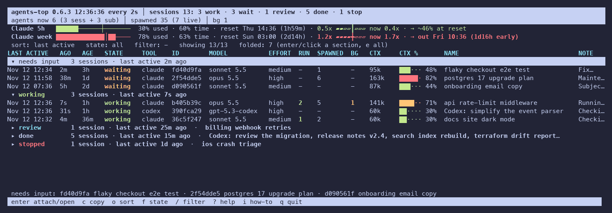
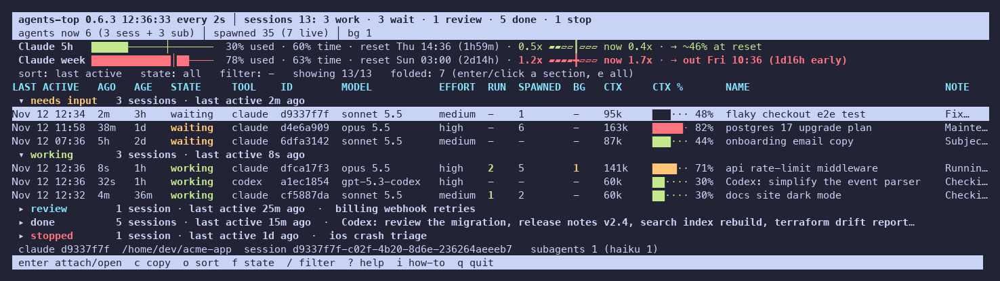

# agents-top

`top` for your Claude Code and Codex sessions: what each one is doing, its model and context usage, and how fast you're using your Claude plan.

[](https://github.com/jachai/claude-top/actions/workflows/test.yml)
[](https://pypi.org/project/claude-agents-top/)
[](https://pypi.org/project/claude-agents-top/)
[](https://github.com/jachai/claude-top/blob/main/LICENSE)



It's a live view of every background session showing when it was last active, what it's waiting on, its model, effort and context size, and the helpers it started. The header shows your 5-hour and weekly plan usage, how fast you're using it, and when you'd run out.

## Install

```sh
uv tool install claude-agents-top   # or: pipx install claude-agents-top
uv tool install git+https://github.com/jachai/claude-top   # the latest from main
```

The package is `claude-agents-top` on PyPI because `claude-top` there is an unrelated project. It installs the `agents-top` command, and `claude-top` as an alias for it (the unrelated project installs a `claude-top` too, so don't install both). This one is a single file with no dependencies: Python 3.9+ on macOS or Linux (on Windows only `--once` works). You can also copy `claude_top.py` anywhere on your `PATH`.

## Show plan usage (optional)

Claude Code hands your plan limits to its status-line command, so agents-top needs to be that command to see them:

```sh
agents-top init          # sets the status line in ~/.claude/settings.json (backs it up first)
agents-top init --wrap   # already have a status line? keep it: record the limits, then run yours
```

Your status line then shows a line like `5h 38% 0.6x · week 54% 1.3x → out Fri 13:37` (with `--wrap`, your own line, unchanged). `--dry-run` shows the change, `--undo` puts things back. If you'd rather edit your own script, add `echo "$input" | agents-top record` to it.

## Use

```sh
agents-top              # full screen, refreshes every 2s
agents-top -s waiting   # only sessions waiting for you (Claude Code calls it "blocked"; -s blocked works too)
agents-top -g billing   # text filter
agents-top -g codex     # Codex sessions
agents-top --once       # print once and exit
agents-top --expand     # start with every section open
```

Sessions sit in sections, like Claude Code's own agents view: **needs input** and **working** are open, while **review**, **done**, **stopped** and **idle 1d+** (anything with no activity for a day, whatever its state; `--idle-hours` changes it) are each folded into one line with how many sessions it holds and their names. So what is still going on is all you see. Enter or a click on a section's line opens or closes it, `→` `←` do the same from the keyboard, and `e` opens every section or puts them back. A state or text filter shows plain rows, no sections. Clicking needs the mouse; `--no-mouse` leaves it to your terminal for selecting text.

| Key | Action |
|---|---|
| `↑` `↓` / `j` `k` | move |
| `enter` | open the session (`claude attach <id>` for background jobs, `claude --resume <id>` for interactive sessions, or `codex -C <folder> resume <id>`); leave it and you are back in the list where you were. On a section's line, open / close it |
| `→` `←` / click | open / close a section (a click on a session selects it) |
| `e` | open every section, or put them back |
| `c` | copy the attach command |
| `o` | sort: last active, created, context, agents, name |
| `f` | filter by state |
| `/` | text filter |
| `r` | show / hide retired session guides |
| `+` `-` | refresh slower / faster |
| `?` | help: every key and column |
| `i` | how to use it, session-guide's commands, and what the title colors mean |
| `u` | update agents-top (offered in the footer when a newer release is out) |
| `q` | quit |

### With session-guide

The top bar shows a legend of its title colors, once you have used it here: 🟥 manager, 🎟️ retired, 🟧 guided, ⬜ watched, 🟦 active, ✅ closed. Press `i` for what each means and how to use the guide.

| Title starts with | Means |
|---|---|
| 🟥🟥 | the active guide (Sessions Manager), always the first row |
| 🎟️🎟️ | a retired guide, one that handed over (hidden; `r` shows it) |
| 🟧🟧 (g) | managed: still in play, reports to the guide |
| ⬜⬜ | watched: the guide reads it and passes on its questions |
| 🟦🟦 | active: running, neither managed nor watched |
| ✅ | finished: the guide closed it, or its ledger row is DONE |

A title is changed by session-guide on that session's next prompt, which a finished session never gets, so agents-top shows `✅` itself for a session whose marker says closed or whose ledger row is DONE. It changes only the display.

If you run [session-guide](https://github.com/jachai/session-guide), agents-top knows its sessions: the active guide (🟥🟥 Sessions Manager) is always on top, and guides that handed over (🎟️🎟️ retired) are hidden. Press `r` or pass `--retired` to see them. It reads the skill's markers in `~/.claude/session-guide/guides/`, and falls back to its default titles.

A worker the guide has finished with shows as **done**, not waiting on you, even while Claude Code still lists it under needs input: either its marker says `done`, or the active guide's ledger lists it in the `## Sessions` table with a Level of DONE, RETIRED, STOOD DOWN or CLOSED. A worker that is actually working stays in working.

## Reading it

- **Header**: sessions by state (`work`ing, `wait`ing for you, `review` = finished in a worktree that's still open, `done`, `stop`ped), then what's running now: working sessions + subagents, subagents spawned in total, and background tasks.
- **Usage bars (5h, week)**: the bar fills with the % of the limit used, and `│` marks how much of the window (`time`) has passed. A bar filled past the `│` means you're ahead of budget.
- **Speed (`1.3x`)**: % used ÷ % of time elapsed. `1.0x` lands exactly on 100% at reset, and `2.0x` runs out halfway through. The gauge's middle line is 1x. **now** is the speed over the last few hours (`--rate-hours`, default 3; the week uses a little more because limits come in whole percents).
- **→**: when you'll run out at the current speed (and how early that is), or roughly where you'll end up at reset.
- **LAST ACTIVE / AGE**: last activity vs. when the session was created. The built-in agents view only shows age.
- **TOOL**: `claude` or `codex`.
- **RUN / SPAWNED**: subagents running now / started in total. **BG**: background shells, monitors and crons in flight.
- **CTX %**: Claude context used (input + cache read + cache creation, no output), measured against agent-guard's `context_ask_tokens` (200k by default). Change it with `-w 1000000` or `CLAUDE_TOP_CONTEXT_WINDOW`. Codex uses the context window recorded in its own log; the percentage is blank when that size is unavailable.



## Try it without your data

```sh
python3 scripts/demo.py   # made-up sessions in a temp dir
```

`CLAUDE_CONFIG_DIR`, `CODEX_HOME`, and `CLAUDE_TOP_RATE_LIMITS` override where it reads from; `CLAUDE_TOP_LIVE=0` skips `claude agents`. Running the tests and regenerating the images is covered in [CONTRIBUTING.md](CONTRIBUTING.md), and changes are listed in [CHANGELOG.md](CHANGELOG.md).

## Codex sessions

Codex sessions appear automatically from `~/.codex/sessions` (or `$CODEX_HOME/sessions`), including sessions created by the CLI and local Codex apps. No setup or running Codex process is required. Saved thread names come from `session_index.jsonl`, with the project folder as a fallback. Child agents are counted under their top-level parent; archived sessions are excluded.

Codex status is inferred from the local rollout log: an active turn is `working`, a completed turn is `done`, and an interrupted turn is `stopped`. An unfinished turn with no recorded activity for 15 minutes is also shown as `stopped`, so a long silent tool call can look stopped until it writes again. The usage bars in the header show **Claude plan limits**; Codex plan limits and background-task counts are not collected.

## Notes

- Claude session states and names come from `claude agents --json`, with open CLI sessions also discovered from `~/.claude/sessions` when that command omits them. Registry status `idle` appears as waiting for input, and `busy` as working; records whose process has exited are skipped. Everything else comes from Claude Code's local files (`~/.claude/jobs`, `~/.claude/projects`, and session-guide's `~/.claude/session-guide/guides`). They aren't a public API, so a Claude Code update can break a column; please [open an issue](https://github.com/jachai/claude-top/issues/new/choose) if it does.
- Codex data comes from local rollout JSONL files and the session-name index. These formats can change between Codex versions. Opening a Codex row uses the documented [`codex resume` command](https://learn.chatgpt.com/docs/developer-commands).
- It reads only local files, and writes only its own files in `~/.claude/claude-top/` and, with `init`, the `statusLine` entry of `~/.claude/settings.json`. Codex files are read only. Once a day the full-screen view asks GitHub for the latest release's version number (nothing about you or your sessions is sent); turn that off with `CLAUDE_TOP_NO_UPDATE_CHECK=1`.
- This is an independent project, not affiliated with Anthropic or OpenAI.

MIT licensed.
